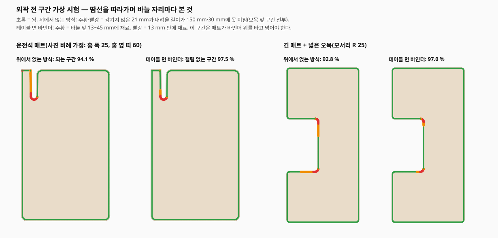

# v2.1 구동 개념 변경안 — 테이프 길(U7)과 바늘 옆 바퀴 조절 범위(U4)

**상태: 확립(2026-11-21, 사용자 동의 — 7절).** 이 내용으로 요구서 0-8을 v2.1로 고쳤다(결정로그 C-51~C-53). 이 문서는 이유·계산 기록이고, 판정은 요구서가 한다.

- 작성 2026-11-21, 안을 낸 쪽 Claude
- 계기: 사용자 2026-11-21 "진행해 진짜 다 바인딩이 되는지도 테스트하고 엔진돌려"
- 바탕: [전체 분석 보고서](../reports/analysis_2026-11-16_overall.md) 5-2 추가, 가상 시험 `tools/out/binder_test/`(`bindtest.py`·`wrap_check.py`·`zfold_check.py`), [벤치마크](../benchmark.md) 「다. 구동부 판독」 6), Dürkopp Adler 867-392342-M 자료
- 낱말: **윗날개** = 매트 윗면에 얹히는 테이프 부분. **접힘선** = 테이프가 윗날개에서 아래로 꺾이는 선(매트 가장자리 바로 위). **땀선** = 바늘이 지나는 선(가장자리에서 6.5 mm 안). **띠** = 홈과 매트 옆 가장자리 사이의 좁은 부분.

## 1. 왜 바꾸나

v2.0 개념의 0-8-2 ④는 "테이프 길은 윗헤드 높이로 지나가 매트와 만나지 않는다"이다. 이 문장 때문에 바인더가 매트 위(Z 13 이상)에 떠 있고, 테이프를 위에서 얹는 자체 고안 바인더(FUNC-01)가 나왔다. 계산해 보니 이 방식은 세 군데에서 성립하지 않는다.

| # | 문제 | 수치 |
|---|---|---|
| 1 | 접힘선이 바늘 25 mm 앞에서 25° 꺾인다. 접혀 내려온 테이프는 그 방향으로 휠 수 없다 | 매트 밑 모서리의 올 +4.0 mm(5.8 %), 아랫날개 끝의 올 +11.4 mm(16.5 %). 설계 계산서의 허용은 2~3 % |
| 2 | 꺾임을 없애도, 감기지 않은 21 mm가 스스로 내려와 감기려면 가장자리가 곧게 150 mm 넘게 이어져야 한다. 오목한 곳 앞에서는 그 자리에 매트가 있다 | 외곽의 3~7 %가 해당(2절). 오목 모서리 하나마다 그 앞 150 mm |
| 3 | 150 mm 넘게 평평하게 가져오려면 테이프가 바늘 앞 매트 가장자리 위를 덮는다 | 가장자리 센서(바늘 앞 109.5 mm)가 가장자리를 못 본다 |

두 번 접어 옆으로 옮기는 자리의 치수 오류(5.6 mm 어긋남)는 고칠 수 있는 설계 오류라 여기에 넣지 않았다.

## 2. 외곽 전 구간 가상 시험

매트 외곽의 땀선을 2.5 mm마다 따라가며 바늘 자리마다 기계 좌표로 봤다(`bindtest.py`, CAD 없이 기하 계산).

| 매트 | 둘레 | 위에서 얹는 방식이 되는 구간 | 테이블 면 바인더가 걸림 없는 구간 | 바늘 앞 13 mm 안에 재료가 오는 길이 |
|---|---|---|---|---|
| 300 × 200 | 948 | 100 % | 100 % | 0 |
| 1500 × 1500 (모서리 R 30) | 5,948 | 100 % | 100 % | 0 |
| 1200 × 1200 + U홈 폭 25 | 5,011 | 96.6 % | 98.5 % | 42 |
| 1200 × 1200 + V홈 30° | 4,949 | 97.0 % | 97.8 % | 78 |
| 1500 × 700 + 넓은 오목(모서리 R 25) | 4,901 | 92.8 % | 97.0 % | 76 |
| 운전석(사진 비례 가정, 홈 25 + 띠 60) | 3,067 | 94.1 % | 97.5 % | 42 |

- 볼록한 곳과 직선은 어느 방식이든 된다.
- 위에서 얹는 방식은 오목한 곳 앞 구간 전체에서 안 된다(그림의 주황·빨강).
- 테이블 면 바인더는 오목한 곳 바로 앞에서만 매트와 자리가 겹친다. 그 구간은 매트가 바인더 위를 타고 넘어야 한다. R375X는 반지름이 볼 지름 하나쯤인 오목 모서리를 이렇게 박은 완성품 사진이 있다(벤치마크 「8) 완성 매트」).
- **좁은 홈의 바닥(R 12.5)과 V홈 꼭짓점은 어느 방식으로도 확인되지 않았다.** 바늘 앞에 비는 자리가 12 mm뿐이다.

테이프가 받아야 하는 변형(땀선 길이만큼 들어간 테이프 기준, 날개 9.5):

| 가장자리 | 접힘선 | 날개 끝 |
|---|---|---|
| 오목 R 12.5 (홈 바닥) | 34 % 남음 | 16 % 모자람 |
| 오목 R 25 | 21 % 남음 | 10 % 모자람 |
| 오목 R 80 | 8 % 남음 | 4 % 모자람 |
| 볼록 R 30 | 28 % 모자람 | 13 % 남음 |

남는 쪽은 잔주름이 되고 모자란 쪽은 당겨진다. 방식과 상관없이 생기는 것이고, 얼마나 보이는지는 테이프 재질에 달렸다(요구서 7절).

## 3. 벤치마크는 어떻게 하나

- **R375X 사진**: 바늘 앞 테이블 면에 납작한 삼각 판(바인더)이 있고, 바늘 오른쪽 테이블 위에 얇게 구부린 덮개가 있다. 테이프는 오른쪽에서 테이블 면을 따라 들어오고, 오른쪽으로 넘어온 매트는 덮개 위를 지난다(벤치마크 6), 신뢰 중간~높음).
- **헤드**: R375G 배지는 Dürkopp Adler M-TYPE 867(Habraken 개조)이다. 867의 바인딩 사양 867-392342-M은 제조사 자료에 이렇게 적혀 있다.
  - 바인더가 이송과 같이 움직인다(mitgehender Einfasser).
  - 안쪽·바깥쪽 반지름에서 장력을 낮춰 감도록 바인더 움직임을 따로 조절한다(차동).
  - 좁은 안쪽·바깥쪽 반지름용으로 미리 정해 두는 둘째 땀 길이가 있다.
  - 봉제 중 통과 높이 10 mm, 노루발을 들면 20 mm.
  - 출처: duerkopp-adler.com 「M-TYPE 867-M SPECIALS」 리플릿(2020-12), partner.duerkopp-adler.com 867-392342-M 쪽.
- **손 작업**: 카펫 바인딩 업체(Bond Products)는 안쪽 모서리를 "카펫을 구부려 가장자리를 곧게 펴서" 박는다고 설명한다. 우리 기계는 매트를 평평하게 둔 채 박으므로 이 방법을 쓸 수 없다. 좁은 홈 바닥이 가장 큰 위험인 까닭이다.

## 4. 변경안

### 4-1. U7 테이프 길을 벤치마크대로

| 요구서 칸 | 지금 | 바꿈 |
|---|---|---|
| 0-8-2 ④ | 테이프 길은 윗헤드 높이로 지나가 매트와 만나지 않는다 | 테이프는 바늘 오른쪽(+X)에서 테이블 면을 따라 바인더로 들어온다. 그 길은 낮은 덮개로 덮고, +X로 넘어온 매트는 덮개 위를 지난다 |
| 0-8-3 U7 하는 일 | 롤 → 안내 → 바인더, 절단·끝 접기, 앞끝 남기기(위에서 내려오는 카세트) | 롤 → 테이블 면 테이프 길 → 헤드의 바인딩 장치(같이 움직이는 차동 바인더 + 테이프 30용 표준 바인더, 구매 D-10). 절단·끝 접기·앞끝 남기기(C-19)는 바늘 오른쪽 테이블 면 쪽에서 |
| 0-8-3 U7 새로 하는 것 | 툴 카세트 원터치 교체 | 그대로(C-20). 묶는 것이 바인더·테이프 안내·덮개로 바뀌고 자리가 테이블 면이 된다 |
| 0-8-2 ⑤ | 툴 카세트는 위치 결정 핀 + 원터치 클램프 | 그대로 |

모델에서 빠지는 것: 바인더 블록 `P_M05_BINDER`와 브래킷, 위에서 내려오는 테이프 안내, 앞끝 보내기 실린더와 발톱, 카세트 판. 높이 조정 축(`J_U7_HGT`)은 U6 센서·슈가 함께 쓰므로 남긴다.

### 4-2. 좁은 홈 (벤치마크에 없는 곳)

- 노루발·슈 묶음 폭 < 홈 폭은 그대로 둔다(0-8-2 ②).
- 바인더와 덮개는 납작하게 만들고, 홈 건너편 벽은 그 위를 타고 넘는다. 높이와 경사는 구매 바인더 치수가 와야 정한다(자료대기).
- 홈 바닥과 좁은 오목에서는 지금처럼 땀마다 멈춰 돌고, 헤드의 둘째 땀 길이와 차동 바인더를 쓴다.
- 그래도 안 되는지는 시제품에서 본다(요구서 7절). 안 되면 그 구간만 바인더를 잠깐 물리는 축을 더한다. 지금은 넣지 않는다.

### 4-3. U4 바늘 옆 바퀴의 X 조절을 안쪽으로도

- 기본 자리 d₁ 100은 그대로다(C-37).
- 손 조절 범위를 100~195에서 45~195로 넓힌다. 사진의 매트는 홈 옆 띠가 약 60 mm라, d₁ 100에서는 띠의 홈 쪽 벽을 박을 때 바퀴가 매트 밖이다.
- 안쪽 한계 45는 임시값이다. 띠 폭 실측(D-213)이 오면 다시 정한다.

### 4-4. 시험 매트 추가

운전석 매트(사진 비례 가정: 몸통 520 × 720, 홈 폭 25·깊이 170·바닥 R 12.5, 띠 폭 60)를 시험 매트로 더한다. 치수는 임시값이다(D-01~D-03).

## 5. 남는 위험

1. **좁은 홈 바닥과 V홈 꼭짓점**: 2절 그대로. 시제품과 손 작업 영상(D-07)으로 정한다.
2. **바인딩 장치 실물 치수가 없다**(D-10). 모델에는 사진 비례의 임시 형상(`STEP대기_`)으로 들어간다. 기종이 정해지면 바꾼다.
3. **헤드 통과 높이 10 mm**: 매트 두께 임시 범위 6~16(D-04)의 위쪽은 이 헤드로 못 박는다. 기종 견적 조건에 넣는다.
4. U7을 다시 그리므로 이음매 동작(절단·끝 접기)도 다시 설계해야 한다.

## 6. 과제 (요구서 5절에 넣을 것)

| id | 과제 | 종류 |
|---|---|---|
| RX-14 | U7 테이프 길을 테이블 면으로 — 위 카세트 걷기, 바인딩 장치·테이프 길·덮개·롤 자리 | 구동 |
| RX-15 | 테이프 절단·끝 접기·앞끝 남기기(C-19)를 새 테이프 길에 맞게 | 구동 |
| RX-16 | U4 X 조절 범위를 안쪽까지(d₁ 45~195) | 구동 |
| RX-17 | 시험 매트 추가: 운전석(홈 + 좁은 띠) | 구동 |
| RX-18 | 외곽 전 구간 바인딩 검증 — 새 바인더·덮개로 모든 매트 연구를 다시 돌려, 타고 넘는 구간과 높이를 목록으로 | 구동 |

RX-13(U4 누름 실린더 자리)은 RX-16 뒤에 한다. 주변 과제 RX-01·02·04·05는 그대로 이어서 한다.

## 7. 동의 기록

2026-11-21, 사용자.

- 질문 "테이프 길(U7)을 어떻게 할까요?"(보기: 벤치마크 방식으로 / 위에서 얹기 유지 / 엔진이 3안 비교 / U7은 보류) → **"벤치마크 방식으로"**. 4-1·4-2가 확립됐다(C-51).
- 질문 "바늘 옆 바퀴(U4)를 바늘 쪽으로도 옮길 수 있게 할까요?"(보기: 안쪽까지 조절 / 지금 그대로) → **"뭐가 더 옳은데"**. Claude가 안쪽까지 조절이 옳다고 답하고 그렇게 정했다(C-52). 사용자가 뒤집을 수 있다.
- 4-4 시험 매트 추가는 Claude가 정했다(C-53, 임시값으로 진행).
