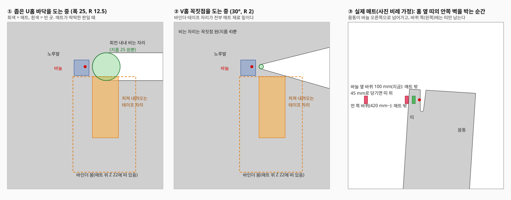
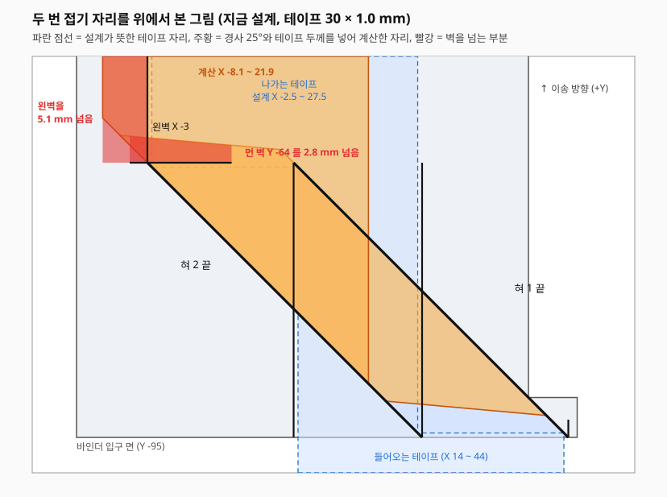
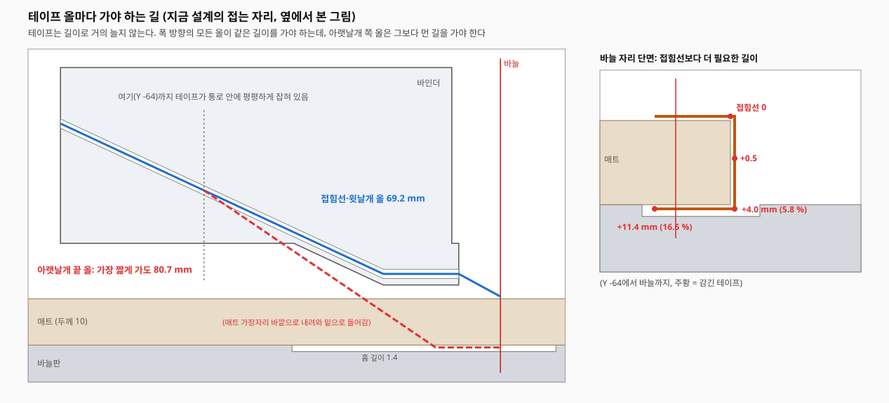

# 전체 분석 — FSAP v2.17.2 (2026-11-16)

엔진을 멈추고 지금 모델 전체를 직접 분석한 결과다. 물음은 하나다: **좁은 홈(V자 모양으로 좁아지는 곳)을 돌려 가며 박을 수 있는가.**

- 대상: `3D_Modeling/FSAP_v2.17.2.sc` (저장본 그대로, 이번 분석에서 모델을 고치지 않았다)
- 실험 자료·계산 스크립트: `tools/out/analysis_1115/`
- 낱말: **바인더(랏빠)** = 테이프를 매트 가장자리에 U자로 감아 주는 접이 기구. **홈** = 매트 테두리가 안으로 깊게 파인 곳. **홈 바닥** = 홈의 가장 깊은 끝(둥근 부분). **띠** = 홈과 매트 옆 가장자리 사이에 남는 좁은 부분.

## 1. 결론

1. **부품이 서로 부딪히지 않고 매트를 돌릴 수 있는가 — 된다.** 사이클 7개의 모든 단계(3,964단계)를 앱에서 돌려 보았고, 충돌은 의도된 것(바늘이 매트에 꽂힘)과 이미 알고 있던 것(바늘 앞 테이프 조각) 둘뿐이다.
2. **좁은 홈을 박을 수 있는가 — 지금 모델로는 증명되지 않았다.** 모델이 '간섭 0'으로 통과한 것은 두 가지 전제 덕분이다. ① 바인더가 매트보다 위에 떠 있다. ② 매트가 완전히 평평하고 딱딱하다. 둘 다 실물에서 확인된 적이 없다.
3. 지금 설계에서 실패할 가능성이 가장 큰 곳은 홈이 아니라 그 앞 단계인 **바인더 원리**다. 상용 바인더가 아니라 자체 고안이고, 직선에서도 검증되지 않았다. 11-18에 테이프가 지나는 길을 계산해 보니 지금 형상으로는 성립하지 않는다(5-2 추가).
4. 실제 매트 사진에는 시험 매트에 없는 것이 있다: **홈 옆의 좁은 띠.** 이 구간에서는 지금 바퀴 자리로는 두 바퀴가 모두 매트 위에 얹히지 못한다.
5. 그래서 순서를 바꾸기를 권한다. 주변 과제(공기 밸브·LED·덮개)를 멈추고, 자료 다섯 가지를 받아 작은 실물 시험을 먼저 한다(7·8절).

## 2. 무엇을 했나

| 실험 | 범위 | 방법 |
|---|---|---|
| 동작 연구 검산 | 사이클 7개 3,964단계 전부 | 앱에서 연구 키를 받아 단계마다 매트 자세를 따로 계산. 바늘과 가장자리 사이 거리가 전 단계에서 6.50 mm로 나오고, 매트 넓이도 모델과 일치 |
| 매트 ↔ 기계 충돌 | 사이클 7개 × 묶음 4~5개 = 30회, 전 단계 | 앱 `motion.interference` |
| 매트 높이 부품 전수 | 기계 부품 3,076개 전부 | 매트가 지나는 높이에 걸친 부품을 가려 내고, 전 단계에서 매트 외곽까지 거리를 계산 (3-1) |
| 기계 ↔ 기계 충돌 | 연구 10개, 움직이는 묶음 5종(U4 그네, 노루발·바늘, U5, 슈, 카세트) | 앱 `motion.interference` (4-1) |
| 액추에이터 중간 자세 | 81자세 | 조인트를 끝과 끝 사이 여러 값에 세우고 앱 `inspect.clearance` (4-2) |
| 손 조절 자세 | U4 X 조절·스토퍼 5자세, 두께 조정 축 4자세, 슈 누름 끝 2자세 | 연구에 없는 조인트를 따로 세우고 앱 겹침 검사 (4-3, 4-6) |
| 정지 자세 겹침 | 부품 796개, 상자가 겹치는 1,832쌍 전부 | 앱 `inspect.interference` (4-4) |
| 볼트와 구멍 | 볼트 758개 전부 | 원통면 자료를 받아 볼트 축에 구멍과 나사 짝이 있는지 계산. 형재 홈은 단면으로 (4-5) |
| 공기 관 | 관 40줄 ↔ 부품·관, 상자가 겹치는 763쌍 | 앱 겹침 검사와 간격 검사 (4-7) |
| 바늘 앞 빈 자리 | V홈·U홈의 벽·바닥 구간 | 매트 높이에서 재료가 한 번도 오지 않는 자리를 계산 |
| 바인더 속 테이프 길 (11-18 추가) | 두 번 접기 자리, 감는 자리 | 테이프를 길이로 늘지 않는 띠로 보고, 놓이는 자리와 올마다 가야 하는 길이를 계산 (5-2 추가) |
| 휘두름·받침 | 사이클 7개 | 매트가 쓸고 가는 범위, 기둥과의 틈, 볼 받침 밖으로 나가는 넓이 |
| 회전력 | V홈·U홈의 회전 구간 | 설계 보고서와 따로 다시 계산, 볼 구름 저항과 매트 크기를 바꿔 봄 |
| 실제 매트 | 사진 비례로 잡은 가정 형상 | 테두리를 한 바퀴 돌리며 바퀴가 매트 위에 있는지 계산 |
| 문서 대조 | 요구서·결정로그·자료대기·설계 보고서 | 위 결과와 맞는지 확인 |

## 3. 가상 실험 결과

### 3-1. 매트를 돌릴 때의 충돌

| 사이클 | 단계 | 매트와 부딪힌 것 |
|---|---|---|
| V홈 (1200×1200, 30°, 바닥 R 2, 깊이 150) | 486 | 바늘(의도), 바늘 앞 테이프 조각(입구 회전·꼭짓점 구간, 깊이 5.0 mm) |
| U홈 (1200×1200, 폭 25, 바닥 R 12.5, 깊이 150) | 514 + 630 | 바늘, 테이프 조각(깊이 4.3 mm) |
| 큰 매트 (1500×1500) | 716 | 바늘, 테이프 조각(모서리 회전, 깊이 1.8 mm) |
| 작은 매트 (300×200) | 450 | 바늘, 테이프 조각(깊이 1.8 mm) |
| 긴 매트 + 넓은 오목 (1500×700) | 583 + 585 | 바늘, 테이프 조각(깊이 5.0 mm) |

그 밖의 부품(노루발·헤드·두 바퀴·슈·센서·카세트·먼 쪽 대차)과는 전 단계에서 충돌이 없다. 계산이 중간에 끊긴 것도 없다.

앱 검사에 넣은 것은 헤드 둘레·두 바퀴·슈·센서·카세트·먼 쪽 대차다(최상위 묶음 115개 가운데 93개). 나머지인 프레임·테이블·공압은 부품 수가 많아 계산으로 덮었다. 기계 부품 3,076개의 자리를 모두 훑어 매트가 지나는 높이(Z 0~30)에 걸친 것을 가려 냈다.

- 테이블에서 Z 0 위로 올라온 부품은 없다.
- 프레임·공압에서 이 높이에 있는 것은 기둥과 라이트 커튼(안전 광선 센서) 기둥뿐이다. 전 사이클 전 단계에서 매트와 가장 가까운 것은 오른쪽 기둥 104 mm(긴 매트), 라이트 커튼 183 mm(큰 매트)다.

'테이프 조각'은 바인더 출구에서 바늘까지 이어지는 7.5 mm 길이의 테이프 모형이다. 매트가 바늘 둘레로 돌면 이 조각과 겹친다. 설계 쪽은 이것을 "실제로는 테이프가 휘는 곳"으로 보고 허용 목록에 넣어 두었다. 5절에서 다시 다룬다.

### 3-2. 휘두름과 받침

| 사이클 | 매트가 쓸고 가는 범위 (X / Y) | 오른쪽 기둥(X 1150)과 틈 | 볼 받침 밖 최대 |
|---|---|---|---|
| V홈 | −1468~915 / −1242~1522 | 235 | 1 % |
| U홈 | −1483~929 / −1235~1506 | 227 | 1 % |
| 큰 매트 | −2112~9 / ±1494 | 1143 (왼쪽 기둥과 191) | 0 % |
| 작은 매트 | −352~9 / −400~294 | 1144 | 4 % |
| 긴 매트 + 넓은 오목 | −1647~1052 / ±1494 | **104** | **35 %** (작업자 자리 위) |

- 프레임과 부딪히는 곳은 없다.
- 긴 매트는 오목한 벽을 박는 동안 매트의 35 %(약 3,100 cm²)가 받침 없이 작업자 자리 위에 뜬다. 처지면 그 무게가 매트를 끌어 땀이 어긋날 수 있다. 이미 구동 후보(RX-12-C1·C2)로 올라 있다.

### 3-3. 회전력

설계 보고서와 따로 계산해 같은 크기를 얻었다(바늘 둘레 관성 4.60·6.15 kg·m², 보고서 6.146).

| 경우 | 볼 구름 저항 0.02 | 0.03 | 0.05 | 0.10 |
|---|---|---|---|---|
| 시험 매트 1200×1200(8.6 kg), 바늘 옆 바퀴 혼자, V 꼭짓점 | 1.26 | 0.88 | 0.54 | 0.28 |
| 같은 매트, V 입구 회전 | 1.09 | 0.75 | 0.47 | 0.24 |
| 같은 매트, 두 바퀴 함께 | 6.8 | 4.7 | 2.9 | 1.5 |
| 750×550 매트(2.4 kg, 가정), 바늘 옆 바퀴 혼자 | 5.6 | 4.4 | 3.2 | 1.9 |
| 1400×500 일체형 뒷매트(4.2 kg, 가정), 바늘 옆 바퀴 혼자 | 3.4 | 2.5 | 1.7 | 0.9 |

값은 여유율(바퀴가 낼 수 있는 회전력 ÷ 필요한 회전력, 가속 빼고)이다. 1보다 작으면 바퀴가 미끄러진다.

- 시험 매트 크기에서 바늘 옆 바퀴 혼자 도는 구간은 **볼 구름 저항이 0.02 근처일 때만** 성립한다. 0.03이면 안 된다. 이 값은 재 본 적이 없다. 볼 하나가 받는 무게가 0.6 N쯤으로 아주 작아서, 볼 유닛 자체의 굴림 저항이 무게에 비해 크게 나올 수 있다.
- 바늘을 꽂은 채 매트를 돌리는 동안 매트는 바늘과 노루발에 옆으로 기대어 돈다. 이 옆힘이 시험 매트에서 구름 저항 0.02면 11~13 N, 0.03이면 17~19 N이다. 설계 보고서는 바늘 몫을 9.8 N 이하로 잡았고, 그때 지름 1.6 mm 바늘의 응력을 약 607 MPa로 셈했다(`mech_DC-04_design.md`). 구름 저항이 가정보다 크면 바늘이 휘거나 부러질 수 있다.
- 그런데 이 빠듯함은 **시험 매트가 너무 커서** 생긴 것이다. 실제 운전석 매트 크기라면 여유가 3~5배 있다. 실제 크기 범위(자료대기 D-01)를 받으면 이 걱정의 대부분이 없어지거나, 반대로 일체형 뒷매트에서만 남는다.

## 4. 기계끼리의 충돌

움직이는 부품이 다른 부품과 부딪히는 곳은 찾지 못했다. 나온 겹침은 모두 테이프 모형이거나 의도된 동작(칼이 테이프를 자름), 또는 끼워 맞춘 자리(축과 부시, 나사, 커넥터)다.

따로 찾은 것이 하나 있다. 볼트 758개 가운데 37개가 물릴 나사 없이 놓여 있다(4-5). 기계가 움직이는 것이나 좁은 홈과는 상관없고, 모델을 다듬는 단계에서 고칠 일이다.

### 4-1. 동작 연구 전 단계

연구 10개(사이클 7개 + 이음매 + 점검 2개, 4,010단계)를 앱에서 재생하며 본 결과다.

| 움직이는 묶음 | 상대 | 본 범위 | 결과 |
|---|---|---|---|
| U4 그네(누름 팔·바퀴·실린더 로드) | 헤드, 노루발, 바늘, 슈, 센서, 카세트, 테이프 줄, 밑 원판, X축 레일 (39쌍) | 연구 10개 전 단계 | 충돌 없음 |
| 노루발·바늘 | 카세트, 카세트 걸이, 테이프 줄, 센서, 밑 원판 (12쌍) | 연구 10개 전 단계 | 충돌 없음 |
| U5 대차·승강·플로트·바퀴 | U5 고정부(레일·벨트·풀리) | 사이클 7개 | 충돌 없음 (아래 ①) |
| U4 그네 | U4 받침(피벗 브래킷·누름 실린더·X 캐리지) | 이음매·점검 연구 3개 전 단계 | 축과 부시가 맞닿은 1쌍뿐(깊이 0.022 mm, 부피 0) (아래 ②) |
| U5 대차·승강·플로트·바퀴 | 공압 관·관 빗·볼트 27개 묶음 | V홈·큰 매트·U홈 사이클 | 충돌 없음. 목록에 뜬 17쌍은 끼워 맞춘 자리이고 겹침 부피 0 (아래 ③) |
| 슈(캐리지·누름판) | 헤드, 노루발, 바늘, 센서, U4, 카세트, 카세트 걸이, 테이프 줄 (26쌍) | 이음매 연구 + 작은 매트 사이클 전 단계 | 충돌 없음. 센서가 슈 캐리지에 붙은 면 1쌍뿐(부피 0) |
| 슈 누름판 | 슈 캐리지 | 이음매 연구 전 단계 | 미끄럼 안내가 맞닿은 1쌍뿐(깊이 0.05 mm, 부피 0) |
| 카세트(손으로 빼기) | 헤드, 노루발, 바늘, 센서, 슈, 카세트 걸이, 롤 받침, 테이프 줄, 관, 볼, U4 (44쌍) | 카세트 점검 연구 전 단계, 옆으로 2.5 mm·앞으로 5 mm 간격 | 부품 충돌 없음. 테이프 모형 2쌍과 커넥터 물림 (아래 ④) |

① 작은 매트 사이클은 전 단계를 돌았다. 나머지 6개는 한 번의 시간 한도(240초)에 앞쪽 40~60 %에서 끊겼다. 못 돈 1,842단계의 대차 자세(X·승강·플로트)를 계산해 보니 돈 구간의 자세와 모두 같았다. 자세 기준으로는 빠진 것이 없다.

② 사이클 연구는 이 짝이 한 단계에 4~30초가 걸려 끝까지 못 돌렸다. 대신 4-2에서 그네 각도 17개를 따로 세워 같은 짝을 봤다.

③ V홈은 226단계, 큰 매트는 152단계, U홈은 228단계에서 시간 한도에 끊겼다. 대차 자세(X·승강·플로트)는 연구 전체에 104가지가 나오는데, 돈 구간에 104가지가 모두 들어 있다. 목록에 뜬 17쌍은 대차 블록이 레일을 감싼 자리 1쌍과 대차에 박힌 볼트·인서트 16쌍이다. 레일 짝은 정적 검사(4-2의 U5 X 4자세)에서도 겹침 0이었다.

④ 카세트를 옆으로 빼는 처음 10 mm 동안은 공기 다중 커넥터의 플러그와 소켓이 물려 있어 앱이 겹침으로 센다(깊이 0.5 mm). 12.5 mm부터는 떨어진다. 테이프 모형과는 두 군데서 겹친다. 카세트 안내가 테이프 줄을 지나는 곳(옆 2.5 mm부터 앞 95 mm까지, 최대 792 mm³)과 테이프 조각이 바늘판에 닿는 곳(19 mm³)이다. 4-2의 카세트 줄과 같은 것이다.

슈가 지나는 자리(옆 이동 −60·−30·0 × 누름 4.5·2.05·−0.4의 다섯 조합)는 작은 매트 사이클의 13~22단계에 모두 나온다. 이음매 연구에는 양 끝만 있어서 사이클을 함께 돌렸다.

### 4-2. 액추에이터의 중간 자세

동작 연구에서 누름·승강·비킴 같은 액추에이터는 끝과 가운데, 2~3점만 지나간다. 짧은 행정은 요구서 6-4가 그렇게 정했다(양 끝 + 가운데, 2026-11-03 시간 줄이기). 그런데 긴 행정도 같은 방식이라 요구서의 이송 간격(25 mm)보다 성긴 곳이 있다. 앞끝 보내기(150 mm)는 75 mm 간격, 슈 옆 이동(60 mm)은 30 mm 간격이고, U4 그네는 가운데 점 없이 1°에서 13°로 건너뛴다.

그래서 조인트를 끝과 끝 사이 여러 값에 세워 놓고 따로 검사했다. 상대는 움직이는 부품이 쓸고 지나가는 범위 안에 자리가 걸치는 부품 전부다(기계 부품 3,076개에서 가려 냄).

| 조인트 | 연구에 나온 값 | 따로 세운 값 | 잰 쌍 | 결과 |
|---|---|---|---|---|
| 노루발 | 0·10·20 | 15·10·5·0·−4 | 11 | −4(두께 6 매트 높이)에서 테이프 조각 모형과 1.1 mm³. 테이프를 10 mm 매트 높이로 그려 둔 탓 |
| 바늘 (노루발 내림) | 0·−15·−30 | −6~−36, 6 간격 | 17 | 없음 |
| U4 그네 | −3.3·0·0.5·1.0·13.0° | 13°~−4.1° 사이 10점(슈 비킴), 7점(슈 작동 자리) | 661 | 없음 |
| 슈 옆 이동 | −60·−30·0 | 10 간격, U4 들림과 내림에서 한 번씩 | 214 | 없음 |
| U5 승강 | −10·10·30 | 20·10·0·−10 | 34 | 없음 |
| U5 플로트 | 0·5·10·11 | 5·10·11·15·20 | 61 | 없음 |
| U7 칼 | 0·7.5·15 | 3 간격 | 72 | 12·15에서 칼날이 테이프 줄 모형을 지남(27~47 mm³). 테이프를 자르는 동작 |
| U7 끝 접기 | 0·7.5·15 | 3 간격 | 70 | 없음 |
| U7 앞끝 보내기 | 0·75·150 | 15 간격 10점 | 169 | 없음 |
| U7 걸쇠 | 0·12 | 4·8·12 | 17 | 없음 |
| U7 카세트 옆 빼기 | 0·12.5·25 | 5 간격 | 788 | 테이프 모형 2쌍(아래) |
| U5 X (보·관·볼트와) | 25 간격 | 345·690·1035·1380 | 258 | 없음 |

모두 81자세, 2,372쌍이다.

- 카세트를 옆으로 빼면 카세트 안내가 테이프 줄 모형을 지나고(344 mm³), 카세트에 붙은 테이프 조각이 바늘판과 겹친다(19~75 mm³). 테이프를 굳은 모양으로 그려 두어서 나오는 것이다. 실물에서는 테이프가 걸린 채로 카세트를 빼면 테이프가 끌린다는 뜻이므로, 빼기 전에 테이프를 끊거나 푸는 순서가 점검 절차에 있는지 확인이 필요하다.
- 앱이 겹침 부피를 내지 못한 쌍은 축과 부시 2쌍, 나사가 물린 볼트 9종, 다중 커넥터의 플러그와 소켓 1쌍이다. 모두 끼워 맞춘 자리이고 기준 목록에 이미 있다.
- 슈 누름(행정 4.9 mm)은 따로 세우지 못했다. 이 조인트는 설계 파일에서 한 번 움직이는 데 3~6분이 걸린다. 그래서 동작 연구를 재생하는 검사로 봤다(4-1의 슈 줄). 양 끝(4.5·−0.4)은 이음매 연구에, 가운데(2.05)는 사이클 연구에 나온다.
- 카세트 안의 칼·끝 접기·앞끝 보내기·걸쇠는 연구 전체에서 한 번에 하나만 움직인다(조합 8가지 모두 한 조인트만 0이 아님). 그래서 하나씩 세운 위 검사로 조합이 빠지지 않는다.

### 4-3. U4 X 조절과 스토퍼

바늘 옆 바퀴(U4)는 매트에 맞춰 손으로 X 방향으로 95 mm까지 옮겨 볼트로 잠그고, 내림 높이는 스토퍼 나사(0~20)로 정한다. 동작 연구에는 이 조절이 들어 있지 않아 따로 세워 봤다.

| 자세 | 본 짝 | 잰 쌍 | 결과 |
|---|---|---|---|
| X 95(끝), 그네 들림 | U4 전체 ↔ 둘레, 그네 ↔ 받침 | 72 | 없음 |
| X 95, 그네 내림(0°) | 같음 | 73 | 없음 |
| X 95, 그네 끝(−4.1°) | 그네 ↔ 받침 | 31 | 없음 |
| X 47.5(가운데), 그네 내림 | U4 전체 ↔ 둘레 | 58 | 없음 |
| X 0, 스토퍼 20(그네가 3.75°에서 멈춤) | U4 전체 ↔ 둘레, 그네 ↔ 받침 | 111 | 슈 공기 관이 제 관 브래킷에 물린 자리 0.03 mm³뿐(정지 자세에도 있는 것, 4-4) |

모두 5자세, 검사 8건, 345쌍이고 부품끼리의 충돌은 없다. '둘레'는 U4가 쓸고 가는 범위에 자리가 걸치는 부품 93개다(테이블 20, 슈 23, 공압 14, 먼 쪽 바퀴 고정부 10, 센서 9, 헤드 4, 벨트·레일·밑 원판 등).

- U4에 달린 공기 관은 X를 옮겨도 모양이 따라가지 않는다. X 95에서 관 조각끼리 어긋나 보이는 것은 그 때문이고, 실물에서 관이 95 mm를 따라올 여유 길이가 있는지는 모델로 볼 수 없다(4-8).

### 4-4. 기계 전체, 정지 자세

정지 자세에서 부품이 서로 파고든 곳이 있는지 앱의 정밀 겹침 검사(`inspect.interference`)로 봤다. 고칠 충돌은 나오지 않았다.

처음에는 기계 부품 3,076개를 한 번에 넣었다. 상자가 겹치는 10,570쌍 가운데 20분 동안 2,450쌍(23 %)만 판정됐고, 겹침은 형재와 마감캡 3쌍이었다. 그래서 대상을 **부품 796개**로 줄여 다시 돌렸다. 뺀 것은 볼트·너트·와셔 1,297개, 테이블 볼 827개, 관·케이블·체인 156개다.

부품끼리는 상자가 겹치는 1,832쌍을 모두 판정했다(76분).

| 판정 | 쌍 |
|---|---|
| 겹침 없음 | 1,647 |
| 겹침 있음 | 18 |
| 앱이 판정하지 못함 | 167 |

**겹침 18쌍**은 끼워 맞춘 자리이거나 임시 형상 탓이다.

| 짝 | 쌍 | 겹친 부피 | 무엇인가 |
|---|---|---|---|
| U5 대차를 끄는 벨트의 곧은 구간 ↔ 풀리에 감긴 구간 | 4 | 171~399 mm³ | 벨트 한 줄을 조각 4개로 그렸고, 조각 끝이 서로 겹쳐 있다 |
| 이음쇠·소음기·막음 플러그 ↔ 밸브 매니폴드 | 6 | 201~221 mm³ | 나사가 박히는 자리. 매니폴드가 임시 형상이라 포트 구멍이 없다 |
| 스토퍼 실린더 로드 ↔ 스토퍼 블록 | 1 | 177 mm³ | 로드 끝 M10 나사가 블록의 탭 구멍에 10 mm 물린 자리 |
| 개별 급기 스페이서 ↔ 옆 밸브 몸체 | 3 | 4.0 mm³ | 0.2 mm 겹침. 스페이서가 임시 형상(두께 10 임시)이다 |
| 형재 ↔ 마감캡 | 3 | 1.2 mm³ | 캡 꽂이가 형재 홈에 끼는 자리 |
| U4 누름 팔의 옆판 ↔ 앞판 | 1 | 0.17 mm³ | 맞닿은 면. 겹친 두께로 치면 0.0002 mm |

**판정하지 못한 167쌍**은 앱이 겹친 부피를 계산해 내지 못한 쌍이다. 지름이 같은 축과 구멍처럼 면이 딱 붙은 자리에서 이렇게 된다. 짝을 하나씩 읽어 보니 다음과 같다.

| 묶음 | 쌍 |
|---|---|
| 구매품 한 개 안의 조각끼리(베어링 고리 ↔ 덮개, 풀리 허브 ↔ 플랜지·세트 나사, 감속기 속, 실린더 몸체 ↔ 마개, 조절기 몸체 ↔ 게이지) | 52 |
| 구매품에 박힌 너트·이음쇠(실린더 ↔ 고정 너트·로드 너트·이음쇠, 밸브·조절기 ↔ 이음쇠) | 45 |
| 받침 롤러 축 ↔ 새들 28, 무급유 부시 ↔ 그네·축 4 | 32 |
| 형재 ↔ 마감캡 | 25 |
| 모터 ↔ 감속기 입력부(모터 축이 입력 클램프에 물림) | 9 |
| 풀리 이 ↔ 벨트 | 2 |
| 공기 다중 커넥터의 플러그 ↔ 소켓 | 1 |
| U4 밑판 ↔ 피벗 브래킷 B (맞닿는 면에 0.0002~0.0005 mm 높낮이가 남음) | 1 |

- 가공품끼리인 쌍은 마지막 줄 하나다. 면 자료를 받아 보니 브래킷 B 윗면(Z 242)에서 구멍을 메운 자리(넓이 23 mm²)가 0.0002 mm 높게 남아 있다. 밑판 밑면에도 0.0005 mm씩 높낮이가 다른 자리가 9곳 있다. 구멍을 옮기면서 옛 구멍을 메운 자국이다(`mech_RX-06_model.md`). 엔진도 이 쌍을 "맞닿는 면의 잔차"로 적어 두었다(`mech_RX-06-C2_verify.md` 디테일 C2-V5). 충돌은 아니고, 납품 STEP·도면을 뽑기 전에 지울 자국이다.
- 이 가운데 기준 목록(`tools/machine.json`의 `baseline_overlaps` 26줄)에 이미 있는 것은 부시 ↔ 축과 롤러 축 ↔ 새들뿐이다. 벨트 조각, 매니폴드 나사 자리, 스토퍼 로드 나사, 스페이서, 마감캡, 모터 ↔ 감속기, 커넥터는 목록에 없다. 엔진을 다시 돌릴 때 기준 목록에 올려야 전체 회귀가 이것들을 새 겹침으로 세지 않는다.
- 볼트 ↔ 부품(상자 겹침 2,270쌍)은 이 검사에 넣지 않고 4-5에서 다른 방법으로 봤다. 테이블 볼 ↔ 부품(839쌍)은 보지 않았다(4-8).
- 4-3에 나온 슈 공기 관 ↔ 관 브래킷 0.03 mm³는 정지 자세에서도 똑같이 나온다. 관이 브래킷 구멍에 물린 자리다.

### 4-5. 볼트와 구멍

볼트가 구멍 없는 살을 지나거나 물릴 나사가 없는 곳이 있는지 따로 봤다. 겹침 검사로는 이것이 잘 잡히지 않는다. 나사가 탭 구멍에 물린 자리는 앱이 겹친 부피를 내지 못하는 일이 많고(4-4의 '판정하지 못함'), 보처럼 큰 부품과 볼트 사이는 계산이 시간 안에 끝나지 않는다. 그래서 볼트와 이웃 부품의 원통면(구멍) 자료를 앱에서 받아, 볼트 축과 같은 축에 구멍이 있는지를 계산했다.

볼트는 모두 758개이고 전부 봤다.

| 결과 | 볼트 |
|---|---|
| 나사 짝이 있다 (형재 T너트 473, 가공품 탭 174, 구매품 탭 55, 너트·인서트 19) | 721 |
| **나사 짝이 없다** | **37** |

나사 짝이 없는 37개는 이렇다. 위 네 줄 32개가 이번에 새로 찾은 것이다.

| 어디 | 볼트 | 상태 |
|---|---|---|
| 보(`P_M07_BEAM`)에 붙인 것: 조절기 6, 터치 화면 받침 4, 밸브 매니폴드 4, 관 빗 4, 경광등 3, 관 클램프 2, L 브래킷 1 | 24 | 보 벽(두께 8)의 그 자리에 탭 구멍이 없다. 볼트가 벽 살을 5~8 mm 그대로 지난다 |
| U5 체인 팔에 단 관 브래킷 2개 | 4 | 볼트가 허공에 있다. 팔은 두께 3 판인데 볼트 자리에는 팔이 없다. 브래킷 하나는 팔에 닿지도 않는다 |
| U4 밑판 옆의 슈 공기 관 브래킷 | 2 | 볼트가 밑판보다 6 mm 아래 허공에 있다. 브래킷은 밑판 옆면에 닿아만 있다 |
| 공기 다중 커넥터 받침 위에 얹은 관 브래킷 | 2 | 볼트 밑에 물릴 살이 없다. 받침은 두께 6 판 두 장이 ㄱ자로 선 모양이고 볼트 자리는 그 판에서 벗어나 있다 |
| 공기 다중 커넥터 소켓을 받침에 고정한 볼트 | 4 | M3 볼트 끝 4 mm가 소켓에 달린 Ø4 핀과 같은 자리에 겹쳐 그려져 있다. 소켓 STEP에 볼트 구멍이 없어 임시로 그린 것이고, 취부 방법이 정해지지 않은 것으로 이미 적혀 있다(디테일 SW-D6, 자료대기 D-137) |
| 옛 클레비스 볼트 | 1 | 허공. 이미 디테일(M02R-D8)로 적혀 있다 |

- **보의 24개**는 두 가지로 확인했다. 보의 원통면 103개 가운데 이 볼트들과 같은 축인 것이 없다. 그리고 볼트 자리 둘레 20 mm 안에 보의 모서리가 하나도 없다(구멍이나 창이 있으면 모서리가 있다). 설계 기록은 이 볼트들이 보에 물린다고 적었다("보 M5 탭", "보 윗벽 물림 8"). 보에는 M5 탭이 87개 있지만 M4 탭은 하나도 없고, 관 클램프처럼 부품을 옮기면서 볼트만 옮기고 탭은 옛 자리에 남은 곳이 있다(볼트 X −362·−350, 탭 X −256·−244).
- 지금까지의 간섭 검사가 이것을 잡지 못한 까닭은 보 ↔ 볼트 쌍의 정밀 계산이 끝나지 않기 때문이다. 이번에도 28쌍을 5분 돌려 한 쌍도 판정되지 않았다. 엔진 기록에도 같은 쌍을 "시간 안에 못 봄, 손계산으로 판정"이라고 넘긴 곳이 있다(개선후보 WF-209).
- 관 브래킷 볼트 8개(체인 팔 4, U4 2, 커넥터 받침 2)는 같은 모양의 빠짐이다. 공기 관 길을 내면서 브래킷과 볼트를 더했는데, 붙일 상대 부품에 볼트가 물릴 자리(탭 구멍이나 살)를 만들지 않았다.
- 감사가 처음에 짝을 못 찾은 볼트 가운데 6개는 하나씩 읽어 보니 짝이 있었다. 센서 고정 볼트 2개는 인서트에, 두께 조정 축의 미는 볼트 2개는 받침 블록의 M4 탭에 물려 있다(둘 다 나사를 호칭 지름으로 그려 둔 것). 체인 끝 브래킷 볼트 2개는 임시 형상 브래킷의 탭에 물려 있다.
- 원통면 자료만으로는 구멍과 돌기(핀)를 가리지 못한다. 그래서 볼트 축 위에 잡힌 원통면 1,630개마다 끝에 마개 면이 있는지(있으면 돌기)를 평면 자료로 따로 가렸다. 돌기인 곳은 두 군데이고 둘 다 구매품 STEP이다. 가공품에는 없다.
  - 공기 다중 커넥터 소켓의 Ø4 핀 4개(위 표).
  - **경광등.** 제품 STEP에는 몸체 밑면에서 Ø4 × 11.5 돌기 3개가 아래로 나와 있다(제품에 달린 고정 스터드로 보인다). 모델은 이 돌기 끝을 보 윗면에 세워 놓아서 몸체 밑면이 보에서 11.5 mm 떠 있고, 같은 자리에 볼트 3개를 겹쳐 그렸다. 설계 기록은 이 11.5를 "밑판 두께"로 읽었다. 돌기를 보 윗벽 구멍에 넣어 몸체를 보에 앉히는 그림으로 고칠 자리다.
- 볼트 머리가 자리 없이 살에 묻히거나 볼트가 옆 부품을 스치는 것도 원통면으로는 볼 수 없다. 그래서 바늘 둘레에서 움직이는 묶음(헤드·U4·U5·U6·U7)은 볼트와 이웃 부품을 앱의 정밀 겹침 검사에도 넣었다. 탭에 물린 볼트 쌍은 한 쌍에 5~9분이 걸린 뒤 '판정하지 못함'으로 끝나서, 그런 쌍은 빼고 볼트가 구멍을 지나거나 옆을 지나는 쌍만 따로 돌렸다. 겹침이 나온 곳은 공기 다중 커넥터 둘레뿐이다. 소켓 고정 볼트 4개(위 표), 그리고 그 위 관 브래킷 볼트 하나가 소켓 받침쇠의 윗날개 끝을 1 mm 파고든 자리(모서리 좌표로 셈한 값 약 4.5 mm³)다. 안 움직이는 묶음(프레임·테이블·공압)은 감사가 후보로 낸 25쌍만 돌렸고 겹침이 없다.
- 형재 홈에 든 볼트 473개는 원통면으로 볼 수 없어 단면으로 봤다. 형재 65개의 끝면 모서리로 단면 윤곽을 만들고 볼트 몸통이 알루미늄 살에 닿는지 계산했다. 닿는 볼트는 없다.
- 테이블 판을 형재에 고정한 접시머리 볼트 102개는 T너트에 2.7 mm만 물려 있다(지름의 0.54배). 볼 테이블을 다시 만들 때 길이를 고칠 일이다.
- 너트·T너트·와셔·인서트 539개도 같은 방법으로 봤다. 볼트가 지나지 않는 것이 42개인데 모두 다른 짝이 있다(레벨러의 T너트 36, 압입 스터드의 너트 4, 실린더 로드 끝이 물리는 인서트 2).
- 거꾸로 볼트가 없는 빈 탭도 셌다. 보의 M5 탭 87개 가운데 8개가 비어 있다. 관 클램프의 옛 자리 2개와, U4를 X 방향으로 옮길 수 있게 바꾸기 전에 밑판·실린더 브래킷을 보 밑면에 바로 달던 자리 6개다. 도면을 뽑기 전에 지울 자리다.

기계가 좁은 홈을 박을 수 있느냐와는 상관없는, 모델을 다듬는 단계의 일이다. 다만 "간섭 0" 판정에 이런 구멍이 있었으므로, 엔진을 다시 돌릴 때 디테일 과제로 올려야 한다.

### 4-6. 두께 조정 축과 슈 누름 끝

동작 연구에 들어 있지 않은 두 가지를 따로 세워 봤다. 매트 두께에 맞춰 바인더 쪽 묶음(카세트 걸이·카세트·센서·슈)을 통째로 올리고 내리는 두께 조정 축(−4~+6, 두께 6~16 매트)과, 슈를 연구의 누름 값(−0.4)보다 더 내린 자리다.

| 자세 | 본 것 | 결과 |
|---|---|---|
| 두께 축 −4(두께 6), 슈 비킴 | 바늘 둘레 부품 159개, 상자가 겹치는 345쌍 | 새 겹침 없음 |
| 두께 축 −4, 슈 작동 자리 | 같음, 349쌍 | 새 겹침 없음 |
| 슈 누름 −2.5(슈 바닥이 두께 10 매트 윗면에 닿는 높이) | 같음, 349쌍 | 새 겹침 없음 |
| 슈 누름 −5.0(실린더 행정 끝, 슈 바닥 Z 7.5) | 같음, 349쌍 | 새 겹침 없음 |
| 두께 축 +6(두께 16), 슈 비킴·작동 자리 | 따라 움직이는 묶음(부품 80개 + 볼트·너트 58개) ↔ 둘레에 남는 부품·볼트 20개 | 겹침 없음 |
| 두께 축 −4, 슈 비킴·작동 자리 (볼트 넣어 다시) | 같음 | 겹침 없음 |

- '새 겹침 없음'은 정지 자세와 견준 것이다. 정지 자세에 이미 있는 겹침 2쌍(스토퍼 로드의 나사 물림, U4 누름 팔의 맞닿은 면)은 모든 자세에서 값이 그대로다.
- 두께 축 +6 두 자세는 첫 검사에서 149쌍·150쌍을 판정하지 못했다(다른 확인 호출을 같이 돌린 탓, 워크플로우 메모 7). 그래서 두께 축을 따라 움직이는 묶음과 그 둘레만 골라 간격 검사(`inspect.clearance`)로 다시 봤다. 이번에는 볼트·너트도 넣었고 자세마다 39~43쌍이 모두 판정됐다. −4 자세도 같은 방법으로 한 번 더 봤다.
- 슈 누름 두 자세는 시간 한도(자세마다 10분) 안에 36쌍·53쌍을 판정하지 못했다. 짝을 읽어 보니 모두 한 구매품이나 한 묶음 안에서 끼워 맞춘 자리(베어링 고리 ↔ 덮개, 실린더 로드 ↔ 너트, 축 ↔ 부시)이고, 슈 누름으로 자리가 바뀌는 쌍은 없다. 슈와 다른 묶음 사이의 쌍은 모두 판정됐다.
- 두께 6 매트에서 슈를 행정 끝까지 내리는 조합(슈 바닥 Z 3.5)은 앱에서 세우지 않고 상자로 봤다. 슈가 쓸고 가는 범위에 자리가 걸치는 부품·볼트·볼은 두께 축을 같이 따라가는 것(슈 캐리지·실린더)뿐이다.
- 두께 축을 옮긴 채 카세트 안의 칼·끝 접기·앞끝 보내기·걸쇠를 움직이는 조합도 상자로 봤다. 이것들이 쓸고 가는 범위에 걸치는 바깥 부품은 두께 조정 받침 블록 하나다. 보내기 캐리지가 이 블록 옆을 0.5 mm 떨어져 위아래로 지나간다. 틈의 방향이 움직이는 방향과 직각이라 두께 축 값에 따라 달라지지 않는다.
- 두께 축 양 끝에서 1 mm 안으로 가까운 쌍도 쟀다. 정지 자세와 같은 26쌍이고 더 가까워지는 쌍은 없다. 맞닿아 미끄러지는 면이 14쌍, 장공 속 볼트(틈 0.25 mm)가 8쌍, 0.5 mm가 2쌍(보내기 캐리지 ↔ 받침 블록, 바인더 ↔ 헤드 앞코), 0.9 mm가 2쌍(받침 블록 볼트 머리 ↔ 보내기 캐리지)이다. 0.5 mm와 0.9 mm는 가공·조립 공차로 닿을 수 있는 틈이므로 디테일 단계에서 넓힐 자리다.

### 4-7. 공기 관

공기 관 40줄이 정지 자세에서 부품을 뚫고 지나는 곳이 있는지 봤다. 관은 굳은 모양으로 그려져 있어서, 여기서 볼 수 있는 것은 관 길을 그릴 때 생긴 겹침뿐이다.

| 짝 | 상자가 겹치는 쌍 | 결과 |
|---|---|---|
| 관 ↔ 부품 (관을 잡는 빗·클램프·관 브래킷은 빼고) | 291 | 모두 판정, 겹침 없음 |
| 관 ↔ 관을 잡는 빗·클램프·관 브래킷 | 222 | 52쌍 판정, 스친 자리 1곳(0.06 mm³). 170쌍은 판정하지 못함 |
| 관 ↔ 관 | 250 | 176쌍 판정, 겹침 없음. 74쌍은 판정하지 못함 |

- 판정하지 못한 쌍은 관이 빗 홈이나 클램프에 맞닿게 그려진 자리와, 관끼리 나란히 붙어 가는 자리다. 앱의 정밀 겹침 계산이 이런 쌍 하나에 12~16분씩 걸려 시간 한도(20분) 안에 끝나지 않았다.
- 스친 자리는 관 한 줄이 관 빗의 홈 벽에 닿은 곳이다. 4-3에 나온 슈 공기 관 ↔ 관 브래킷(0.03 mm³)과 같은 종류다.
- 앱의 겹침 검사(`inspect.interference`)는 긴 관 네 줄에서 틀린 값을 냈다. 관이 보내기 실린더, U4 X축 레일과 블록, 테이프 롤 받침의 핀·롤러 들과 겹쳤다고 25건이 나왔는데, 겹친 부피가 모두 상대 부품 전체 부피와 같았다. 이 관 네 줄은 상대 부품 83쌍 전부를 간격 검사(`inspect.clearance`)로 한 쌍씩 다시 쟀다. 모두 떨어져 있고, 가장 가까운 곳이 테이프 롤 기둥 옆 7 mm다. 위 표의 '겹침 없음'은 이 값으로 고친 것이다(워크플로우 메모 9).

### 4-8. 못 본 것

- 관과 케이블 체인은 굳은 모양으로 그려져 있다. 움직이는 부품에 달린 관이 휘면서 걸리는지는 모델로 볼 수 없다.
- 관이 빗·클램프에 맞닿은 자리 170쌍과 관끼리 붙은 자리 74쌍은 앱이 판정하지 못했다(4-7).
- 탭에 물린 볼트와 구매품 속 끼움 자리는 앱이 겹친 부피를 내지 못한다. 볼트는 원통면 감사로(4-5), 끼움 자리는 짝 이름을 읽어 분류했다(4-4).
- 테이블 볼 827개와 그 받침의 겹침은 보지 않았다. 볼 테이블은 다시 만들 예정이다.

## 5. 핵심 판단 — 좁은 홈

그림은 바늘 둘레를 위에서 본 것이다. 회색이 매트, 흰색이 빈 곳, 빨간 점이 바늘이다. ①②는 5-3, ③은 5-4의 내용이다.

### 5-1. 모델이 통과한 이유

바늘 둘레 부품의 바닥 높이는 이렇다(매트 윗면은 Z 10).

| 부품 | 바닥 높이 | 매트 윗면과 틈 |
|---|---|---|
| 노루발 | Z 12 | 봉제 중 맞닿음 |
| 슈 | Z 12 안팎 | 약 2 |
| 바인더 끝 쐐기 | Z 13 | 3 |
| 카세트 판 (X 50~58) | Z 20 | 10 |
| 바인더 몸 | Z 22 | 12 |

매트 높이(Z 0~11)에 있는 것은 바늘과 테이프 조각뿐이다. V홈 설계 보고서도 "묶음 바닥이 모두 Z 12 이상이라 반대쪽 벽 위를 지나간다"고 적었다(`mech_VGR-01_design.md` 70행).

즉 좁은 홈에서 홈 건너편 매트는 이 부품들 **밑의 3~12 mm 틈**으로 지나간다는 설계다. 매트가 평평한 판이면 지나간다. 실제 카펫 매트는 파일이 서 있고 가장자리가 말리고 두께가 고르지 않다. 홈에서 나오는 길에는 건너편 벽이 이미 테이프를 감은 뒤라, 테이프 두께(위아래 한 장씩)만큼 더 높다. 테이프가 1 mm면 쐐기 밑 틈은 3 mm가 아니라 1~2 mm다.

### 5-2. 바인더 원리가 검증되지 않았다

모델의 바인더 `P_M05_BINDER`는 상용품이 아니라 이 기계용으로 고안한 출력품이다(`mech_FUNC-01_design.md`).

- 테이프의 윗날개만 위에서 매트 윗면에 얹는다.
- 나머지(옆면 + 아랫날개, 21 mm)는 바인더 바닥의 열린 틈으로 처져 내려온다.
- 아랫날개를 매트 밑으로 넣는 일은 **바늘판에 판 얕은 홈(깊이 1.4 mm)**이 맡는다. 밀어 넣는 부품은 없다.
- 보고서 스스로 "모델로 판정 못 함"이라고 적었다.

상용 바인더는 아래쪽에도 접이 판이 있어 테이프를 매트 밑으로 확실히 끌고 들어간다. 그 판이 매트 높이에 있어서 좁은 홈의 건너편 벽과 부딪힌다. 지금 설계는 그 판을 없애 매트 높이를 비웠다. 좁은 홈 요구를 풀려고 한 선택인데, 그 대가로 **감는 동작 자체의 근거가 없어졌다.** 직선에서 테이프가 고르게 감기는지부터 모른다.

이것은 바인더 한 개를 출력해 재봉기에 달아 보면 하루 안에 알 수 있다.

#### 11-18 추가 — 테이프가 지나는 길을 계산했다

시험 1에 쓸 출력 파일을 뽑으면서, 테이프가 바인더 안에서 실제로 놓이는 자리를 계산했다. 테이프는 길이로 늘지 않는 띠로 봤다. 계산 스크립트와 시험품은 `tools/out/binder_test/`에 있다(`README.md`부터). 낱말: **혀** = 테이프가 감아 도는 얇은 판(두께 1.2). **접힘선** = 윗날개가 얹히는 바닥판의 오른쪽 끝(X 6.5). **올** = 테이프의 길이 방향 실.

**① 두 번 접어 옆으로 옮기는 자리에서 테이프가 통로와 어긋난다.**

- 접는 선(혀 끝)을 평면도에서 45°로 그렸다. 테이프가 놓인 면이 25° 기울어 있어 테이프 면에서는 42.2°다. 테이프는 90°가 아니라 84.4° 돈다.
- 테이프가 혀 끝을 감아 돌 때 혀 두께와 테이프 두께만큼 길이를 더 쓴다. 설계 계산서는 접기를 두께 없는 선으로 보고 '평면 변형 0, 성립'이라고 적었다(`mech_FUNC-01_calc.md` 106행).
- 두께 1.0 mm 테이프가 나가는 자리는 X −8.1 ~ 21.9다(설계 −2.5 ~ 27.5). 통로 왼벽(X −3)을 5.1 mm, 가운데 층의 먼 벽(Y −64)을 2.8 mm 넘는다. 테이프 두께를 0으로 봐도 왼벽을 2.7 mm 넘는다. 통로 양쪽 틈은 0.5 mm씩이다.
- 고치려면 접는 선을 테이프 면에서 45°가 되게 다시 긋고, 두 혀 끝의 간격을 테이프 두께에 맞춰 줄여야 한다. 테이프 두께가 정해져야 한다(D-06).

**② 감는 자리에서 올의 길이가 맞지 않는다.**

- 테이프는 Y −64까지 통로 안에 평평하게 잡혀 있고, 69 mm 뒤 바늘 자리에서 매트를 감은 모양이 되어야 한다.
- 접힘선은 25° 내리막을 내려오다 Y −25.3에서 수평으로 꺾인다. 윗날개는 면 밖으로 굽으면 되지만, 접혀 내려온 옆면·아랫날개는 자기 면 안에서 꺾여야 한다. 천은 그 방향으로 휘지 않는다. 계산서는 이 꺾임을 '직물 굽힘이라 문제 없음'으로 봤다(107행).
- 가장 짧은 길로 가도 매트 밑 모서리의 올은 접힘선 올(69.2 mm)보다 4.0 mm(5.8 %), 아랫날개 끝의 올은 11.4 mm(16.5 %) 더 가야 한다. 계산서가 직조 테이프에 허용한 평면 변형은 2~3 %다(105행).
- 테이프가 그만큼 늘 수는 없다. 남는 길은 올이 서로 어긋나는 것(결이 약 30° 비스듬해짐)뿐이고, 직조 테이프에서는 주름이 되거나 아랫날개가 매트 밑으로 덜 들어간다고 본다.
- 접힘선이 꺾이지 않고 테이프가 바늘 앞 300 mm에서 평평하게 수평으로 들어오면, 같은 계산에서 길이 차가 1.1 mm(0.35 %)로 준다.

**뜻.** 위의 '검증되지 않았다'는 '지금 형상으로는 성립하지 않는다'로 바뀐다. 위에서 얹는 원리 자체가 안 된다는 뜻은 아니다. 문제는 테이프를 '25°로 내려와 바늘 25 mm 앞에서 수평으로 꺾는' 길이다. 그래서 시험 1의 시험품을 둘로 나눴다(8절).

덧붙여, 모델의 윗날개 통로 가운데(Y −25.3)에 두께 0.00015 mm인 막이 남아 있다. 경사 자르기와 평평 자르기가 맞닿은 자리이고, 모델링 보고서의 'Boolean retry 변위 0.0002 mm' 경고가 이것이다(`mech_FUNC-01_model.md` 51행). 형상으로는 통로가 막혀 있다.

### 5-3. 매트 높이에서 바늘 앞에 비는 자리

바인더가 결국 매트 높이에 무언가를 두어야 한다면 그 자리가 얼마나 남는지 계산했다. 매트를 딱딱한 판으로 볼 때, 회전 구간 내내 재료가 한 번도 오지 않는 자리다.

| 구간 | 바늘 오른쪽(가장자리 바깥)에 늘 비는 자리 |
|---|---|
| U홈 안쪽 벽 (바닥으로 가는 중) | 폭 24.5 mm, 바늘 앞으로는 12 mm까지만 |
| U홈 바닥 회전 | 바늘 오른쪽 19 mm 점을 중심으로 한 지름 25 mm 원 |
| V홈 벽 (꼭짓점으로 가는 중) | 바늘 앞쪽으로는 없음 (건너편 벽이 다가옴. 틈 = 꼭짓점까지 남은 거리 × 0.5) |
| V홈 꼭짓점 회전 | 꼭짓점 원(지름 4 mm)뿐 |

- **V홈(30°, 바닥 R 2)**: 매트가 평평한 채로는 어떤 바인더도 들어갈 자리가 없다. 테이프 자체(두께 1 mm)도 재료와 겹친다. 이 형상은 매트를 벌리거나 들어 올려야만 박을 수 있다. 이어진 테이프로 감으면 꼭짓점에 테이프가 17 mm 남아 뭉치고, 날개 끝은 29 % 늘어나야 한다(설계 보고서 계산). 직조 테이프로는 안 된다.
- **U홈(폭 25, 바닥 R 12.5)**: 바인더의 매트 높이 부분이 폭 23.5 mm 안에 들어가게 설계돼 있어 벽 구간은 틈 1.5 mm로 통과한다. 바닥 회전에서는 그 자리 대부분이 재료 밑이 된다. 처져 내려온 테이프(21 mm)를 매트가 쓸고 지나간다. 모델은 이 테이프를 그리지 않았다(바늘 앞 7.5 mm만 그렸다). 테이프 길이도 맞지 않는다. 바닥 반원에서 땀선(반지름 19)은 59.7 mm인데 접힘선(반지름 12.5)은 39.3 mm, 날개 끝(반지름 22.5)은 70.7 mm다. 테이프는 땀선에서 고정되므로 접힘선 쪽은 20 mm(34 %)가 남아 주름이 되고, 날개 끝은 18 % 늘어나야 평평하게 눕는다. 지금 손 작업품이 이 곡선을 어떤 테이프로 어떻게 처리하는지가 답이다(자료 2·3).

### 5-4. 실제 매트에는 '홈 옆 좁은 띠'가 있다

사용자가 준 사진(`docs/concept/images/mat_carpet_narrow_u_slot.webp`)의 홈은 매트 한쪽 가장자리에 붙어 있다. 홈과 옆 가장자리 사이에 좁은 띠가 남는다. 시험 매트는 홈이 1200 mm 변의 가운데에 있어 이런 띠가 없다. 문서에도 이 경우는 없다.

두 바퀴는 모두 바늘의 왼쪽(매트 몸통 쪽)에 있다. 띠의 안쪽 벽을 박을 때는 바늘 왼쪽에 띠만 있고 몸통은 오른쪽으로 넘어간다.

사진 비례로 잡은 가정 형상(몸통 520×720, 띠 폭 85·길이 170, 홈 입구 45 → 바닥 25)으로 계산했다.

| 바늘 옆 바퀴 자리 (바늘에서) | 띠 구간에서 두 바퀴 모두 매트 밖 | 홈 구간에서 두 바퀴 모두 매트 밖 |
|---|---|---|
| 100 mm (지금) | 36 % | 19 % |
| 45 mm | 7 % | 2 % |
| 100 mm, 띠 폭이 120이면 | 5 % | 0 % |

- 바퀴가 없는 구간에서는 매트를 헤드의 이송만 끌고, 방향을 잡을 것이 없다.
- 지금 모델은 바늘 옆 바퀴 자리를 100~195 mm로 조절한다(RX-06R). 필요한 방향은 반대다(더 가까이).
- 치수는 사진 비례 가정이다. 실제 띠 폭을 받아야 한다.

### 5-5. 가장자리 센서는 홈 바닥을 못 본다

센서는 바늘에서 109.5 mm 앞의 가장자리를 읽는다. 홈 바닥에 가까워지면 센서는 이미 바닥을 지나 재료 위에 있다. 계산으로 확인했다: V 꼭짓점·U 바닥 회전 구간 내내 센서는 재료에 덮여 있다.

홈 바닥이 어디서 시작하고 반지름이 얼마인지는 기계가 미리 알아야 한다. 지금 원칙은 "차종별 프로그램 없이 센서로 따라간다"(C-01·C-02)이다. 홈 바닥만큼은 이 원칙으로 풀리지 않는다.

### 5-6. 판단

| 물음 | 판단 | 근거 |
|---|---|---|
| 매트를 돌리는 동작에서 부품 충돌이 있는가 | 없다 | 3·4절 |
| 폭 25·바닥 R 12.5 홈을 박을 수 있는가 | **모른다.** 지금 설계 그대로는 실패 가능성이 높다 | 바인더 원리 미검증(5-2), 띠 구간에 바퀴 없음(5-4), 센서가 바닥을 못 봄(5-5), 건너편 벽이 3~12 mm 틈으로 지나감(5-1) |
| 30°·바닥 R 2 같은 뾰족한 V를 이어진 테이프로 박을 수 있는가 | 안 된다고 본다 | 5-3. 실제 제품에 이런 형상이 있는지부터 확인 |
| 상용 기계는 어디까지 하는가 | 공개된 최소 안쪽 반지름은 R 30. R375X 사진·브로셔에 좁은 홈 실적 없음 | 결정로그 C-17, `benchmark.md` |

사람은 지금 이 홈을 손으로 박고 있다. 그러니 원리상 불가능한 일은 아니다. 다만 사람은 매트를 구부리고 벌리고 바인더 위로 넘기면서 박는다. 지금 설계는 매트를 평평하게 둔 채 박으려 하고, 그 방법이 되는지 본 사람이 없다.

## 6. 유닛별 점검

| 유닛 | 지금 상태 | 걸리는 것 |
|---|---|---|
| U3 헤드 | 기종 미정(자료대기 D-10). 모델은 임시 상자 | 기둥 없는 분리 헤드(윗헤드를 매달고 아랫유닛을 따로 구동, C-18)는 이 기계에서 가장 어려운 구매·개조품이다. R375X는 전문 업체가 개조한 헤드를 쓴다(사진의 "customized by HABRAKEN"). 누가 만들지, 얼마인지 정해진 것이 없다 |
| U4 바늘 옆 바퀴 | 그네식 누름, 바늘에서 100 mm | 띠 구간에서 바퀴 자리가 멀다(5-4). 실린더 자리는 RX-13(C-50). 누름 힘 범위 40~51.6 N은 손계산이고 눌림자국 실측이 없다(D-05·D-92). 전임 기계가 퇴짜맞은 바로 그 항목이다 |
| U5 먼 쪽 바퀴 | 전폭 대차, 행정 1.38 m | 실제 매트 크기에서는 쓸 일이 드물 수 있다(3-3). 크기 자료(D-01)가 있어야 판단된다 |
| U6 슈·센서 | 슈 바닥 길이 130, 센서는 바늘 109.5 앞 | 홈 바닥을 못 본다(5-5) |
| U7 테이프 | 자체 고안 바인더, 위에서 내려오는 카세트 | 5-2. R375X는 사진 판독으로 테이프가 오른쪽 테이블 면을 따라 들어오고 그 위를 절곡 덮개가 덮어 매트가 타고 넘는 것으로 보인다(`benchmark.md` 237행, 신뢰 중간~높음). 우리는 테이프가 위에서 내려오고 카세트 판이 Z 20까지 내려와 있어 매트가 그 위로 넘어갈 수 없다 |
| U2 테이블 | 볼 827개(피치 100), 먼 쪽 바퀴 밑 롤러 2줄 | 구름 저항 미측정(3-3), 긴 매트 받침 밖 35 %(3-2) |
| U1 프레임·U8 공압 | — | 충돌 없음. 급한 것 없음 |

모델과 문서:

- 모델: 피처 3,687개, 오류 0, 경고 53, 바디 3,224개. 저장 안 된 변경 없음.
- 자료대기가 213줄이다. 그중 사용자·납품처에서 와야 하는 기본 자료(매트 크기·홈 치수·테이프·손 작업 영상·품질 기준·헤드)가 10월 30일부터 비어 있고, 핵심 판단이 모두 여기에 걸려 있다.
- 요구서 7절에 옛 구조(v1.0)의 항목이 남아 있다(진공 배관, 에어 테이블 사슬). 지금 구조와 무관하다.

## 7. 아이디어

갈 수 있는 길은 셋이다. 어느 쪽인지는 8절의 시험 1~3이 정한다.

- **길 A — 위에서 얹는 방식을 살린다.** 되면 매트 높이가 비어 있어 좁은 홈에 유리하다. 지금 형상 그대로는 안 된다(5-2 추가). 살리려면 테이프를 꺾임 없이 가져오는 길로 다시 잡아야 한다. 그 길은 바늘 앞쪽 매트 가장자리 위를 지나므로 U6(가장자리 센서·슈) 자리와 함께 다시 잡아야 한다. 시험품 F로 원리부터 본다(8절).
- **길 B — 상용 바인더 + 낮은 경사 덮개(R375X 방식).** 테이프를 오른쪽 테이블 면을 따라 들이고, 바인더를 바늘판에 낮게 붙이고, 그 위를 매끈한 경사 덮개로 덮어 홈 건너편 매트가 타고 넘게 한다. 위에서 내려오는 카세트 판과 실린더는 매트가 넘어가는 길에서 치운다. 좁은 홈 안에서는 바인더의 매트 높이 부분이 홈 폭 안(폭 25면 20 mm 이하, 바늘 앞으로 짧게)에 들어가야 한다. 요구서 0-8-2 ①(매트 층에는 바늘과 테이프만)과 ④(테이프 길은 위로)를 고치는 구조 변경이다.
- **길 C — 테이프가 밑에서 올라오는 바인더(새 안).** 지금 설계의 약점은 가장 어려운 동작(아랫날개를 10 mm 두께 매트 밑으로 넣기)을 밀어 주는 부품 없이 맡긴 데 있다. 거꾸로 하면 이 동작이 없어진다. 테이프를 테이블 밑에서 들여 아랫날개는 바늘판의 얕은 홈을 따라 처음부터 매트 밑에 깔리게 하고, 옆면은 가장자리 선의 가는 틈으로 세워 올리고, 윗날개만 매트 위에서 접어 내린다. 윗날개 접기는 매트 위쪽이라 자리가 있고 노루발이 눌러 준다. 매트 높이에 남는 것은 테이프 한 장뿐이라 좁은 홈의 건너편 벽이 걸릴 것이 없고, 테이프 길도 매트와 만나지 않는다. 바늘판 밑의 가마·이송 톱니와 자리가 겹치는지, 테이프를 꿰기 쉬운지가 관건이다. 해 본 사례를 알지 못하므로 시험이 필요하다.

좁은 홈 안에서 바인더가 차지하는 자리를 줄이는 보조 안이 셋 있다. 길 B·C 어느 쪽에도 붙일 수 있다.

- **미리 접어 굳힌 테이프(센터폴드).** 테이프가 이미 U자로 접혀 오면 바늘 근처에는 접는 기구가 필요 없고 얇은 안내만 남는다. 홈 폭 25 mm 안에 넣기가 훨씬 쉽고, 아랫날개도 처음부터 접혀 있다. 지금 쓰는 테이프가 무엇인지(자료 3)에 달렸다.
- **홈 바닥을 도는 동안만 바인더 끝을 물린다.** 바닥 회전에서 늘 비는 자리는 지름 25 mm 원뿐이다(5-3). 그 구간(땀 10개쯤)만 작은 실린더로 바인더 끝을 들어 올리거나 뒤로 빼고, 이미 접힌 테이프는 노루발이 눌러 준다. 미리 접힌 테이프와 함께 써야 성립한다.
- **건너편 벽을 들어 주는 얇은 승강 판.** 덮개의 경사에 매트가 걸려 밀리지 않도록, 홈에 들어갈 때 바인더 오른쪽에서 얇은 판이 올라와 건너편 벽을 덮개 위로 올려 준다. 홈 자리를 미리 아는 경우(아래 2번)에 쓸 수 있다.

어느 길이든 테이프가 매트 가장자리에 붙는 자리는 바늘에 더 가까워야 한다. 지금은 바늘 9 mm 앞이다. 안쪽 반지름 12.5 mm 곡선에서는 9 mm 앞의 가장자리가 직선일 때보다 3.8 mm 안으로 들어와 있어 테이프와 매트가 그만큼 겹친다(3-1의 깊이 4.3 mm가 이것이다). 5 mm 앞이면 1 mm로 준다.

어느 길이든 함께 필요한 것:

1. **바늘 옆 바퀴를 바늘 가까이(45~60 mm), 폭을 좁게.** 띠 위에 바퀴가 얹히게 한다(5-4). 조절 방향도 안쪽으로 바꾼다. R375G 사진에서도 바퀴는 헤드 바로 옆에 있다. 그래도 띠에서 힘이 모자라면 바늘 오른쪽 뒤에 들어 올릴 수 있는 보조 바퀴를 하나 더 두는 안이 있다(몸통이 오른쪽으로 넘어가 있을 때 몸통을 직접 잡는다).
2. **홈 바닥은 형상 자료로.** 납품 매트는 재단 도면이 있다. 차종별 외곽을 미리 넣고, 센서는 매트가 놓인 자리의 어긋남만 보정한다. 센서가 못 보는 구간이 없어진다. 결정로그 C-02가 '보조 후보'로 남겨 둔 것을 홈 구간에 쓰는 것이다. 다른 방법은 바늘 10~15 mm 앞에 두 번째 센서를 두는 것이다.
3. **시험 매트를 실제 외곽으로 바꾼다.** 지금 1200×1200 정사각에 가운데 홈은 무게는 지나치고(여유율을 깎는다) 띠는 없다. 운전석·조수석·일체형 뒷매트의 실제 외곽으로 연구를 다시 만든다.
4. **'접히는 매트' 모형.** 매트 모형을 홈을 따라 두 조각으로 나누고 경첩 조인트로 잇는다. 건너편 벽을 들어 올린 자세를 CAD에서 만들 수 있어, 덮개를 타고 넘을 때의 간섭과 필요한 높이를 가상으로 볼 수 있다. 딱딱한 판 하나로는 못 보던 것이다.
5. **헤드.** (가) 개조 헤드를 살 수 있는지 Habraken·Dürkopp Adler에 견적을 넣는다. (나) 기둥이 있는 장암(long-arm) 기성 헤드로 되는지 본다. 사진 비례 운전석 매트는 바늘 오른쪽으로 최대 약 460 mm 넘어간다. 암이 그보다 길면 분리 개조 없이 된다. 일체형 뒷매트는 더 넘어가므로 실제 크기가 필요하다.
6. **곡선에서 멈추지 않기.** 지금 연구는 꼭짓점에서 땀마다 멈추고 돈다(V 꼭짓점에서 바늘 옆 바퀴 혼자 9.2초, 입구 12.5초). 바닥 R 12.5면 땀선 반지름이 19 mm라 땀 4 mm마다 12°다. 이송과 회전을 함께 하는 연속 봉제가 되는지 시험한다. 사이클 시간이 여기서 갈린다.
7. **뾰족한 V가 실제로 있다면** 꼭짓점에서 테이프를 끊고 겹쳐 잇거나, 납품처와 최소 반지름을 협의한다.

## 8. 먼저 할 작은 시험

모델링보다 앞에 둔다. 모두 며칠 안에 끝나는 크기다.

| 시험 | 준비물 | 알게 되는 것 |
|---|---|---|
| 1. 바인더 | 시험품 F(윗날개 길이 꺾이지 않고 수평, 나머지는 풀어 둠)와 S(지금 설계의 감는 자리 그대로, 두 번 접기만 뺌) 출력 — `tools/out/binder_test/`. 홈을 판 바늘판(또는 대용 판), 재봉기, 실제 테이프·매트 | F: 위에서 얹고 아랫날개를 홈으로 넣는 원리가 직선에서 되는가. 안 되면 길 B·C. S: 지금 감는 자리가 실제 테이프로 되는가(5-2 추가 ②의 확인) |
| 2. 손 작업 관찰 | 작업자가 홈을 박는 영상(D-07) | 매트를 얼마나 벌리고 들어 올리는가, 바인더 모양, 홈 바닥의 테이프 처리 |
| 3. 넘어가기 | 상용 바인더 위에 경사판을 대고 홈 건너편을 넘겨 봄 | 필요한 높이와 경사, 매트가 그만큼 휘는가 |
| 4. 볼 구름 저항 | 볼 유닛 몇 개, 매트, 저울 | 0.02가 되는가(D-96) |
| 5. 눌림자국 | 바퀴 고무, 추, 매트 | 40~50 N에서 자국이 남는가(D-05·D-92) |

## 9. 받아야 할 자료

1. 실제 매트 외곽(재단 도면, 또는 자를 대고 찍은 사진): 가장 좁은 홈의 폭·깊이·바닥 반지름, 홈 옆 띠 폭, 전체 크기, 두께 — D-01·D-02·D-03·D-04·D-11
2. 손으로 홈을 박는 영상 — D-07
3. 쓰는 테이프와 바인더(랏빠)의 실물이나 사진·사양 — D-06·D-10
4. 헤드 방향(개조 헤드 견적을 넣을지) — D-10
5. 납품 품질 기준과 전임 기계 퇴짜 사유 — D-08·D-09

## 10. 권하는 순서

1. 9절 자료 1~3을 받고 8절 시험 1~3을 한다.
2. 그 결과로 바인더·테이프 길(U7)과 바늘 옆 바퀴 자리(U4)를 다시 구상한다. 요구서 0-8-2를 고치는 일이라 사용자 결정이 필요하다.
3. 시험 매트를 실제 외곽으로 바꾸고 연구를 다시 만든다.
4. 그 뒤에 엔진을 다시 돌린다. 지금 줄 서 있는 주변 과제(RX-01·02·04·05)와 RX-13은 2번 뒤로 미룬다. U4·U7이 바뀌면 다시 해야 하기 때문이다.

## 11. 이 분석의 한계

- 5-4의 매트 치수는 사진 비례로 잡은 가정이다.
- 5-2 추가의 계산은 테이프를 길이로 늘지 않는 띠로 본 것이다. 테이프 폭 30은 사용자가 확인했다(11-18). 테이프 두께 1.0과 매트 두께 10은 설계의 준비값이다. 실제 테이프가 올을 틀어 얼마나 받아 주는지는 시험 1로 본다.
- 5-2의 "실패 가능성이 높다"는 원리를 읽고 내린 판단이지 시험 결과가 아니다.
- 회전력 계산은 설계 보고서와 같은 가정값(면밀도 6 kg/m², 바퀴–파일 마찰 0.4, 바퀴 누름 40 N)을 썼다. 가정값 자체는 실측이 없다.
- 매트와 테이프의 휨·늘어남은 모델로 볼 수 없다. 요구서 7절 그대로다.

## 워크플로우 메모

엔진과 CAD 도구 쪽에서 본 것이다. 설계 결정이 아니어서 결정로그에는 넣지 않았다. 엔진에 반영할 내용은 `docs/reports/engine-candidates.md`에 WF-221~229로 올렸다.

1. **행정이 긴 액추에이터의 중간 자세가 검사에서 빠진다.** 동작 연구의 키가 끝과 가운데뿐이어서, 행정이 15 mm를 넘는 것도 그 간격으로만 검사된다(앞끝 보내기 75 mm, 슈 옆 이동 30 mm, U4 그네 12°). 이번에 따로 세워 본 81자세에서는 충돌이 없었다(4-2). 손으로 맞추는 조절 축(U4 X 위치, 스토퍼, 두께 조정)은 연구에 아예 없어서 이것도 따로 세웠다(4-3, 4-6).
2. **슈 누름 조인트는 설계 파일에서 한 번 움직이는 데 3~6분이 걸린다.** 다른 조인트는 0.5초 안팎이다. 같은 움직임을 동작 연구 재생으로 보면 표본 33개에 20초다. 슈 누름을 직접 움직이는 검사가 느린 까닭 가운데 하나다. 원인은 찾지 못했다. 한 번은 128분이 걸렸다(4-6의 누름 −2.5 자세로 갈 때). 그 사이 PC 절전 기록은 없고 앱 메모리도 정상(10 GB)이었다. 바로 다음 구동은 10분, 체크포인트 복원은 12분이었다.
3. **5분이 넘는 CAD 호출도 결과를 받을 수 있다.** 부르는 쪽이 앱의 응답 한도(약 300초)보다 먼저 끊으면 결과를 잃고, 그 요청이 남아 다음 호출(복원 포함)이 실행되지 않는다. 330초까지 기다린 뒤 `pending`을 되풀이하니 20분짜리 호출의 결과도 받았다. 개선후보 WF-205를 보완하는 내용이다.
4. **동작 간섭 검사는 한 번에 넣는 부품 수에 한도가 있다.** 양쪽을 합쳐 170개까지는 돌았고 278개는 "too many bodies"로 거절됐다.
5. **기계 전체 겹침 검사는 한 번에 끝나지 않는다.** 기계 부품 3,076개를 넣으면 20분에 23 %만 판정한다(상자가 겹치는 10,570쌍 가운데 2,450쌍). 볼트·볼·관을 뺀 부품 796개(1,832쌍)는 76분에 전부 판정했다. 그 시간의 대부분은 구매품끼리 끼워 맞춘 8쌍(쌍당 27~37분)에 들어갔다(4-4).
6. **볼트가 구멍 없는 살을 지나거나 나사 짝이 없는 것은 겹침 검사로 잡히지 않는다.** 탭에 물린 볼트는 앱이 겹친 부피를 내지 못해 '판정하지 못함'이 되고, 큰 부품과 볼트 사이는 시간 안에 끝나지 않는다. 그래서 볼트가 맞게 물린 것과 살을 지나는 것이 같은 칸에 들어간다. 원통면 자료(`body_topology`)로 볼트 축의 구멍을 세는 방법은 바디 1,777개를 받는 데 8분쯤, 계산은 몇 초다. 이번에 나사 짝 없는 볼트 37개를 이렇게 찾았다(4-5). 엔진 도구 목록에 '만들 차례'로 적힌 볼트 검사 도구(WF-050)가 이 일이다.
7. **겹침 검사를 동시에 두 개 부르면 작업 스레드를 나눠 쓴다.** 두께 축 +6 자세 검사(시간 한도 10분)가 다른 검사와 겹쳐 돌면서, 판정하지 못한 쌍이 2~3쌍에서 149·150쌍으로 늘었다. 분석 중에 다른 확인 호출을 같이 돌린 탓이다. 그 두 자세는 따로 다시 돌렸다(4-6). 혼자 돈 검사도 실행마다 판정하지 못한 쌍 수가 달랐다(2~3쌍, 36쌍, 53쌍). 못 본 쌍은 수만 보지 말고 기준 실행과 견주어 짝을 읽어야 한다.
8. **앱이 주는 바디 상자가 실제보다 큰 바디가 있다.** 길이 1,720 형재가 2,850으로 나오는 식이다. 끝 자리나 맞닿음을 상자로 판단하면 틀린다. 면·모서리 자료로 봐야 한다.
9. **앱의 겹침 검사가 틀린 값을 내는 쌍이 있다.** 스플라인을 따라 쓸어 만든 긴 관 네 줄에서는 겹친 부피로 상대 부품 전체 부피를 돌려줬다(25건, 실제로는 7~450 mm 떨어져 있음). 볼트 하나와 구매품 사이에서는 겹침 상자가 볼트 밖까지 나갔다(볼트는 길이 방향 11.0~24.0인데 겹침은 11.5~26.5, 부피 99 mm³. 면 자료로 셈하면 28 mm³). 겹침 결과는 상자가 두 바디의 공통 범위 안인지, 부피가 상대 부품 전체와 같지 않은지 검산해야 한다.
10. **관은 간격 검사로 보는 편이 맞다.** 겹침 검사는 관 ↔ 관 빗 한 쌍에 12~16분이 걸리는데, 간격 검사(`inspect.clearance`)는 떨어져 있는 쌍을 0.2초에 잰다. 다만 간격 검사는 시간 한도가 없다. 맞닿은 쌍이 하나 끼면 호출이 통째로 몇 분씩 돌아오지 않고, 부르는 쪽이 끊어도 앱 안의 계산은 취소되지 않고 계속 돈다. 한 쌍씩 짧은 대기 시간으로 부르고, 안 돌아오는 쌍은 '맞닿은 쌍'으로 따로 모으는 방식이 그나마 낫다.
11. **탭에 물린 볼트 쌍이 겹침 검사 시간을 다 먹는다.** 볼트와 부품을 함께 넣은 묶음 5개가 시간 한도(10분)에 372쌍을 못 봤다. 한 쌍이 5~9분 돌다가 '판정하지 못함'으로 끝난다. 그런 쌍 126개를 빼고 나머지 138쌍만 다시 돌리니 49호출이 3분 반에 끝났다.
12. **유연한 띠의 길을 선으로만 본 계산이 그대로 통과했다(11-18 추가).** 바인더 설계의 계산서는 접기를 두께 없는 평면도의 선으로 보고 "평면 변형 0"이라 적었고, 접힌 테이프가 꺾이는 곳은 "직물 굽힘"으로 넘겼다. 측정·검도·검증은 이 계산을 다시 하지 않았다. 유연한 것의 거동은 시제품으로 미룬다는 규칙이, 기하로 계산할 수 있는 길이와 자리까지 미루는 데 쓰였다(5-2 추가).
